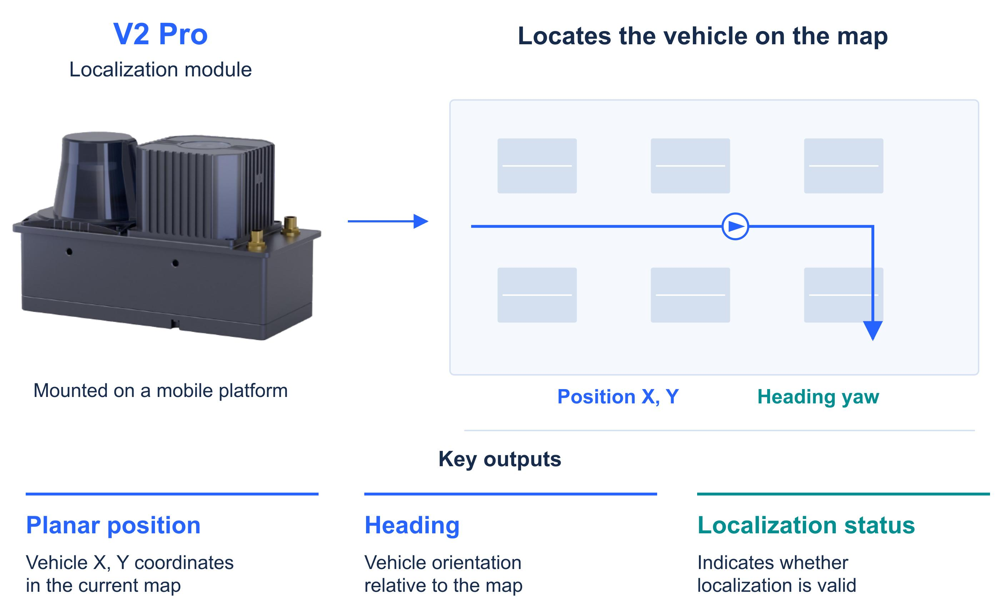
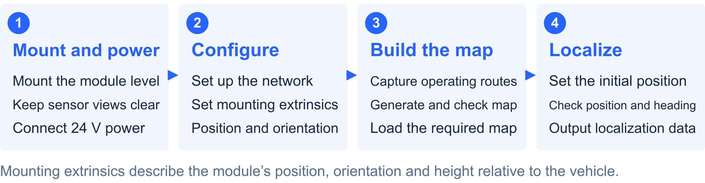
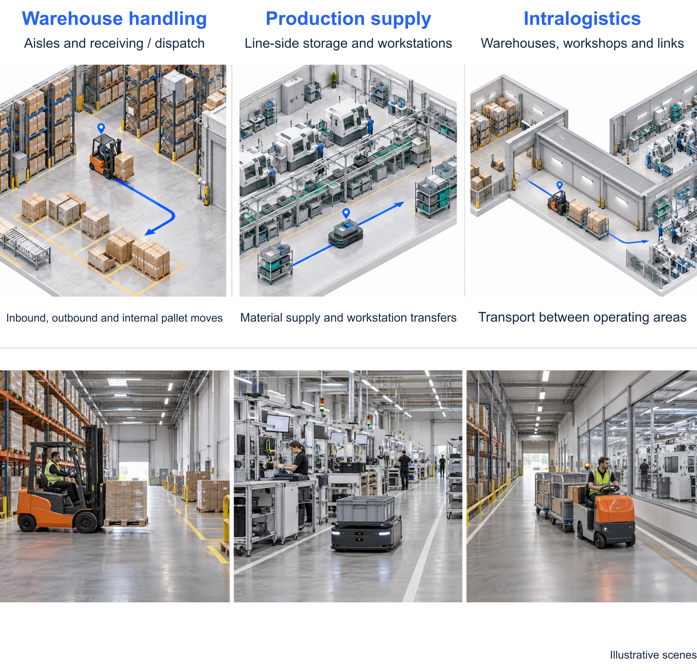

<p align="center"></p>

<a id="mrdvs-v2-pro---infrastructure-free-fusion-slam-localization-module"></a>
<h1 align="center">MRDVS V2 Pro Localization Module</h1>

<p align="center"><strong>Onboard LiDAR, vision and IMU fusion for vehicle position, heading and localization status.</strong></p>

> **Before you update:** Check the installed Body, Frontend and embedded firmware versions. Use the matching packages and upgrade instructions. White Paper V0.1 is a document revision, not a firmware version.

<details>
<summary><strong>Software history</strong> · V1.2.0 / V1.1.1</summary>

<a id="software-update-history"></a>

| Release | GitHub publication date | Notes / packages |
| --- | --- | --- |
| V1.2.0 | 2026-06-12 | [Release Notes](releases/README.md#v1-2-0) · [Original Release](https://github.com/Lanxin-MRDVS/V2Pro-Kit/releases/tag/V2-Pro-V1.2.0) |
| V1.1.1 | 2026-03-10 | [Release Notes](releases/README.md#v1-1-1) · [Original Release](https://github.com/Lanxin-MRDVS/V2Pro-Kit/releases/tag/Firmware) |

The release version does not replace the individual component versions. Existing asset names and historical dates are retained. All detailed software changes are collected in one [Release Notes](releases/README.md) file.

</details>

<details>
<summary><strong>Document history</strong> · White Paper V0.1 / existing deployment guides</summary>

<a id="document-update-history"></a>

| Document | Version | Document date | Read |
| --- | --- | --- | --- |
| Localization Module Product White Paper | V0.1 | 2026-10-09 | [English PDF](Document/V2Pro_Localization_Module_Product_White_Paper_V0.1.pdf) |
| First-Time Setup & Mapping Guide | Unversioned | Not specified | [Guide](Document/First-Time%20Setup%20%26%20Mapping%20Guide.md) |
| Firmware Upgrade & Device IP Modification | Unversioned | June 2026 | [Guide](Document/Firmware%20Upgrade%20%26%20Device%20IP%20Modification.md) |

The existing guides retain their original paths and interface instructions. Check the installed software before using those instructions. The white paper describes the product and its operating limits; it does not certify every capability against every historical firmware package.

</details>

<p align="center">
  <a href="#start-here"></a>
  <a href="#latest-software"></a>
  <a href="#integration"></a>
</p>

<a id="1-overview"></a>
<table>
<tr>
<td width="66%" valign="top">
<strong>Localization for mobile equipment</strong><br><br>
V2 Pro combines an upward-looking camera, 2D LiDAR, IMU and onboard computing in one factory-calibrated module. It builds maps and supplies planar position (X, Y), heading and localization status to vehicle controllers and management systems.<br><br>
<br><br>
The module provides localization. Vehicle motion control, goods identification and fleet applications remain responsibilities of the integrating system.
</td>
<td width="34%" valign="top">
<strong>Release status</strong><br><br>
<strong>Latest software</strong><br>
<code>V1.2.0</code> · 2026-06-12<br>
<a href="#latest-software">Firmware packages</a> · <a href="releases/README.md#v1-2-0">Release Notes</a><br><br>
<strong>Latest white paper</strong><br>
<code>V0.1</code> · 2026-10-09<br>
<a href="Document/V2Pro_Localization_Module_Product_White_Paper_V0.1.pdf">English White Paper</a><br><br>
<strong>Deployment guides</strong><br>
<a href="Document/First-Time%20Setup%20%26%20Mapping%20Guide.md">Setup and mapping</a><br>
<a href="Document/Firmware%20Upgrade%20%26%20Device%20IP%20Modification.md">Firmware upgrade</a><br><br>
<a href="#user-content-software-update-history"><strong>View software history ↑</strong></a><br>
<a href="#user-content-document-update-history">View document history ↑</a>
</td>
</tr>
</table>

## Start here

<table>
<thead><tr><th width="620" align="left">Step</th><th width="240" align="left">Resource</th></tr></thead>
<tbody>
<tr><td>1. Check product fit, mounting requirements and operating limits</td><td><a href="Document/V2Pro_Localization_Module_Product_White_Paper_V0.1.pdf">White Paper</a></td></tr>
<tr><td>2. Check installed versions and follow the required upgrade path</td><td><a href="Document/Firmware%20Upgrade%20%26%20Device%20IP%20Modification.md">Upgrade Guide</a></td></tr>
<tr><td>3. Connect, create a map, initialize localization and validate the route</td><td><a href="Document/First-Time%20Setup%20%26%20Mapping%20Guide.md">Setup &amp; Mapping Guide</a></td></tr>
<tr><td>4. Integrate pose data and check status and timestamps</td><td><a href="#integration">Integration interfaces</a></td></tr>
</tbody>
</table>

<p align="center"></p>

<a id="4-resources"></a>
## Latest software

Current public release: **V1.2.0**, published **2026-06-12**. These are device update packages, not PC application installers.

| Component | Use | Download |
| --- | --- | --- |
| Web frontend | Paired with the algorithm package in this release | [Frontend Package](https://github.com/Lanxin-MRDVS/V2Pro-Kit/releases/download/V2-Pro-V1.2.0/rob0525.zip) |
| Localization algorithm | Body component; update with the matching frontend | [Algorithm Firmware](https://github.com/Lanxin-MRDVS/V2Pro-Kit/releases/download/V2-Pro-V1.2.0/hontai_2.1.43-V2-Normal_971b8_260529A0529_200954_md5182a8.zip) |
| Hardware patch | Apply through LxCameraViewer as directed in the upgrade guide | [Hardware Patch](https://github.com/Lanxin-MRDVS/V2Pro-Kit/releases/download/V2-Pro-V1.2.0/V2Pro-update-V1.1.2_260609.bin) |
| Integrated firmware | Used when the Web Front-End upgrade option is missing; see release instructions | [Integrated Firmware](https://github.com/Lanxin-MRDVS/V2Pro-Kit/releases/download/V2-Pro-V1.2.0/V2_firmware_update_260324_V1.1.2.bin) |

Read the [Release Notes](releases/README.md#v1-2-0) and [Upgrade Guide](Document/Firmware%20Upgrade%20%26%20Device%20IP%20Modification.md) before choosing packages. The frontend and algorithm packages are coupled for this release. After upgrading, check the Frontend and Body versions in the web interface. Do not treat all four packages as an unconditional installation sequence.

## Tools and integration downloads

| Resource | Use | Download / guide |
| --- | --- | --- |
| LxCameraViewer | Embedded firmware update and device IP configuration | [Windows Installer](https://github.com/Lanxin-MRDVS/CameraSDK/releases/download/SDK-V2.4.60/MRDVS-2.4.60.260126-windows-installer.exe) · [Ubuntu Package](https://github.com/Lanxin-MRDVS/CameraSDK/releases/download/SDK-V2.4.60/LxCameraViewer-ubuntu20-viewer.tar.gz) |
| ROS 1 SDK | ROS 1 integration | [SDK Package](https://github.com/Lanxin-MRDVS/V2Pro-Kit/releases/download/V2-Pro-V1.2.0/V2_ROS1.zip) · [Interface](https://github.com/Lanxin-MRDVS/V2Pro-Kit/wiki/V2-Pro-ROS1-Interface) |
| ROS 2 SDK | ROS 2 integration | [SDK Package](https://github.com/Lanxin-MRDVS/V2Pro-Kit/releases/download/V2-Pro-V1.2.0/V2_ROS2.zip) · [Interface](https://github.com/Lanxin-MRDVS/V2Pro-Kit/wiki/V2-Pro-ROS2-Interface) |
| Positioning QR codes | Optional relocalization assistance; register codes in the current map | [QR Code Templates](https://github.com/Lanxin-MRDVS/V2Pro-Kit/releases/download/V2-Pro-V1.2.0/V2Pro_QRcode_tags.zip) · [Deployment Guide](https://github.com/Lanxin-MRDVS/V2Pro-Kit/wiki/Relocalization-QR-Code-Deployment) |

LxCameraViewer is used for the documented firmware and IP tasks; normal configuration and mapping use the device's browser-based platform.

<a id="5-system-highlights"></a>
## Capabilities

| Capability | Application |
| --- | --- |
| Sensor fusion | Combines LiDAR, upward-looking vision and IMU to estimate position and heading onboard. |
| Mapping and extensions | Creates maps, extends existing coverage with overlapping mapping runs, and manages saved maps. |
| Relocalization | Initializes pose by registered QR code, vehicle-marker placement or position and heading entry. |
| Map reuse | Distributes an existing map to other vehicles, subject to mounting height and environmental requirements. |
| Optional external odometry | Accepts vehicle motion data when available; physical odometry is not mandatory for standalone localization. |
| System integration | Supplies pose, timestamps, localization status, map/device information and task feedback. |

<a id="2-key-applications"></a>
## Applications

V2 Pro supplies localization for AGVs, AMRs and material-handling vehicles in warehouses, production facilities and intralogistics. Customer systems can use the output for vehicle tracking, route analysis and digital-twin applications. Goods tracking additionally requires item identity and loading or unloading records.

<p align="center"></p>

<a id="3-technical-specifications"></a>
## Key specifications and operating limits

The following values come from **White Paper V0.1**, and apply when its installation, environmental and map requirements are met. Validate the delivered firmware and actual operating routes for the project.

| Parameter | Specification / condition |
| --- | --- |
| Localization output | Planar X, Y position, heading and localization status |
| Localization accuracy | 1–3 cm position error; ±1° heading error |
| Valid pose output | 20 Hz; output latency <20 ms. Update interval and latency are different measures. |
| Vehicle speed | Up to 15 km/h for localization; up to 3 km/h for mapping |
| Map creation | Up to 20,000 m² and 2,000 m cumulative travel per normal mapping session |
| Operating environment | Primarily indoor; brief outdoor sections require route-specific assessment |
| Camera | Upward-looking; 1–15 m to overhead features; 108° × 57° field of view (±3°) |
| LiDAR | 270° scan; 15 m range at 10% reflectivity / 40 m at 90% reflectivity |
| Connectivity | 100 Mbit/s Ethernet; 2.4 GHz Wi-Fi; CANopen; 2 digital inputs and 2 digital outputs |
| Power and enclosure | 24 V DC / 3 A supply; 19.2–28.8 V input; IP54; −20 to 60 °C operation |
| Size and weight | 146.5 × 66.3 × 89.4 mm; approximately 543 g |

Keep the camera and LiDAR views clear and mount the module level on a rigid structure. Avoid long, feature-poor routes and prolonged direct sunlight on the camera. Reusing a map after a small mounting-height change requires a difference of no more than 50 cm and unchanged surrounding LiDAR features. Use a separate map for each floor.

Coordinates alone do not establish valid localization: check localization status and timestamps. The module continues computing onboard, so communication loss and localization failure are different conditions. Full performance definitions and limits are in the [White Paper](Document/V2Pro_Localization_Module_Product_White_Paper_V0.1.pdf).

<a id="6-documentation"></a>
## Integration

The existing Wiki pages remain the protocol references; their URLs are unchanged.

| Interface / task | Reference |
| --- | --- |
| HTTP | [HTTP Communication Protocol](https://github.com/Lanxin-MRDVS/V2Pro-Kit/wiki/V2-Pro-HTTP-Communication-Protocol) |
| MQTT | [MQTT Communication Protocol](https://github.com/Lanxin-MRDVS/V2Pro-Kit/wiki/V2-Pro-MQTT-communication-protocal) |
| UDP | [UDP Communication Protocol](https://github.com/Lanxin-MRDVS/V2Pro-Kit/wiki/V2-Pro-UDP-Communication-Protocol) |
| ROS 1 | [ROS 1 Interface](https://github.com/Lanxin-MRDVS/V2Pro-Kit/wiki/V2-Pro-ROS1-Interface) |
| ROS 2 | [ROS 2 Interface](https://github.com/Lanxin-MRDVS/V2Pro-Kit/wiki/V2-Pro-ROS2-Interface) |
| QR-assisted relocalization | [QR Code Deployment](https://github.com/Lanxin-MRDVS/V2Pro-Kit/wiki/Relocalization-QR-Code-Deployment) |

## Repository layout

```text
Document/   English white paper, existing guides and documentation index
img/        Existing images and shared page visuals
releases/   One consolidated Release Notes file; binaries stay in GitHub Releases
README.md   Product overview, current downloads and collapsed version histories
```

[Documentation index](Document/README.md) · [Maintenance guide](Document/maintenance.md) · [All software Releases](https://github.com/Lanxin-MRDVS/V2Pro-Kit/releases)

<sub>Zhejiang MRDVS Technology Co., Ltd. · <a href="https://mrdvs.com/v2-pro-rtls-slam-solution">Product website</a></sub>
